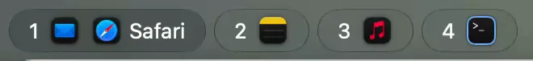
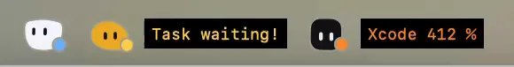
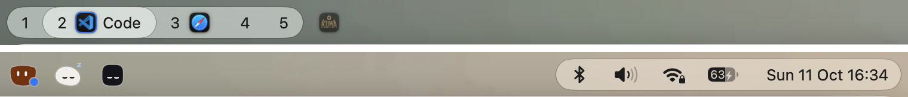
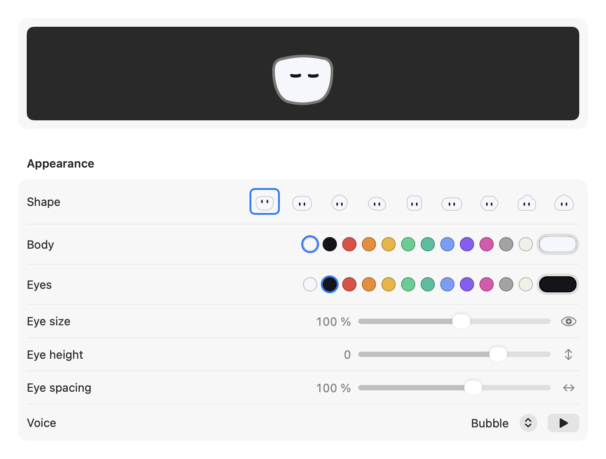

# Siigil

**A bar that sits alongside the macOS menu bar, adds what it's missing and keeps your space tidy.**

https://github.com/user-attachments/assets/e9af5ffe-626a-4e45-acff-e1cf709bb3da

**[Download Siigil](https://github.com/p-diego/siigil/releases/latest)** · macOS 26

## Workspaces

  

Every [AeroSpace](https://github.com/nikitabobko/AeroSpace) workspace becomes a glass pill with the icons of its
windows. Click a pill to jump there; drag an app onto another pill and its window moves with it. A ring around an icon
tells you when the AI agent inside is working, waiting for you or done.

## Mascots

  

Little creatures that keep an eye on your AI agents and on your Mac. One reads along while Claude Code works, another
hops when Codex needs you, a third shakes when an app hogs the CPU or the Mac runs hot. Make your own: nine shapes, any
colour, a voice of its own.

## Widgets

  

Clock, battery, sound, Wi-Fi, Bluetooth, Focus and Now Playing, in pills that change with what's happening. Right-click
one for its menu.

## Get started

1. Download `Siigil-<version>.dmg` from the [latest release](https://github.com/p-diego/siigil/releases/latest)
   and drag Siigil to Applications.
2. macOS blocks the first launch because the app is signed but not notarized: open System Settings › Privacy & Security
   and click **Open Anyway**. You only do this once.
3. The Welcome window walks you through the rest: AeroSpace (recommended), the permissions and Shortcuts your widgets
   need, and the Claude Code and Codex hooks.

Siigil updates itself. Requires macOS 26 or later; AeroSpace is optional.

---

## Details

<picture>
  <source media="(prefers-color-scheme: dark)" srcset="images/bar-dark.png">
  
</picture>

### Workspaces, mascots and widgets

**Workspaces.** One pill per AeroSpace workspace, with the icons of its windows and the name of the app in front. Click a
pill to go there, click an icon to focus that window, right-click it to show, hide or quit the app. Drag an icon onto
another pill to move the window to that workspace. Without AeroSpace, a single pill shows the open apps. The ring around
an icon is blue while its AI agent works, yellow when it waits for you, green when it is done.

**Mascots.** Drawn live by the app, they breathe, look around and follow your pointer. You create them in Settings ›
Mascots and give each one a job:

- **AI monitor** watches Claude Code, Codex or both. It sleeps when no agent is working, reads while one works (and now
  and then spins its eyes around its head), calls you when an agent waits for you, and celebrates when it's done. Click it
  to jump to that session; right-click it for your sessions and your Claude and ChatGPT usage limits.
- **System monitor** watches CPU, heat and memory. When an app burns more than a full core for a minute, the Mac runs hot
  or memory is under pressure, it opens its eyes wide, shakes and tells you who's to blame. Right-click it to quit the
  culprit or ignore it until it stops.

Each thing you watch (Claude, Codex, CPU, heat, memory) has at most one mascot. Mascots make soft sounds, synthesized by
the app itself.

<picture>
  <source media="(prefers-color-scheme: dark)" srcset="images/settings-mascot-dark.png">
  
</picture>

**Widgets.** Clock (click opens the app you choose, ⌥-click toggles Do Not Disturb), battery, volume (click to mute),
Wi-Fi with signal and VPN, Bluetooth, Focus, Now Playing for Spotify and Music, and the apps running without a window.
Right-click a widget for its menu: networks, devices, audio outputs and more. ⌘-drag a widget to move it, even across the
notch.

**Looks.** Transparent glass, the default, or a theme: Catppuccin, Nord, Dracula, Gruvbox, Monochrome. Light, dark or
automatic; the font of the clock and the workspaces (SF Pro, SF Mono, SF Rounded, New York); margins and corner radius.
One bar per screen; on a MacBook the pills stay to the left of the notch. The bar steps aside for full-screen apps.

### First launch and updates

On its first launch Siigil starts at login, hides the macOS menu bar and turns off macOS window snapping, which gets in
AeroSpace's way. You can change all three in Settings › General, where you'll also find the Welcome window again.

Siigil checks for a new version at launch and once a day. When one is out, right-click a mascot and choose **Update to
…** (or use Settings › General › Check now): Siigil downloads it, checks that it carries the same signature, replaces
itself and restarts. Your permissions stay. If the update can't be installed, the same menu item brings you here to
download the DMG.

### Settings

Right-click a mascot and choose **Settings…**, or open Siigil again from Finder or Spotlight. There are five pages:
General, Pills, Appearance, Mascots and AI accounts.

### Permissions and privacy

Siigil only asks for what the widgets you turn on need:

- **Full Disk Access** for the Focus widget: macOS keeps the Focus state in `~/Library/DoNotDisturb`.
- **Location** for the Wi-Fi network name, which macOS only reveals to apps with Location access.
- **Bluetooth** for your devices.
- **Automation** for Spotify or Music, the first time you use Now Playing.
- The Shortcuts it offers to add for the widgets that need them (Siigil DND, Siigil Low Power, Siigil Bluetooth),
  because macOS doesn't let apps toggle Do Not Disturb, Low Power Mode or Bluetooth on their own.

To follow your AI agents and show your usage limits, Siigil:

- installs small hooks in `~/.claude/settings.json` and `~/.codex/hooks.json`, merged with yours and with a backup, that
  send each session's state to Siigil over a local socket;
- reads the Claude Code token from your Keychain and the Codex token from `~/.codex/auth.json`, only to ask Anthropic and
  OpenAI for your usage limits and account name.

Apart from that, Siigil only goes online to:

- check GitHub for a new version, at launch and once a day, and download it when you choose to update;
- look up your public IP address with [ipify](https://www.ipify.org) when you open the Wi-Fi menu, which shows it
  (remembered for 5 minutes per network);
- download the album artwork of what's playing in Spotify, from Spotify.

Nothing else leaves your Mac.

### How it works

The agents' hooks run a one-line script that passes each event to Siigil over a local socket; the mascots and the rings
follow from there. Workspaces come straight from AeroSpace's own socket, events included, so the bar updates the moment
something changes. The bar itself is a borderless panel at the top of each screen, in the strip of the hidden macOS menu
bar.

To build it yourself, see [DEVELOPMENT.md](DEVELOPMENT.md).

### Credits

- Theme colours: [Catppuccin](https://github.com/catppuccin/catppuccin), [Nord](https://github.com/nordtheme/nord),
  [Dracula](https://github.com/dracula/dracula-theme) and [Gruvbox](https://github.com/morhetz/gruvbox), MIT License.

The license texts ship inside the app, in `Siigil.app/Contents/Resources/Licenses`, and the credits are in Siigil › About
Siigil.

### License

Siigil is open source under the [MIT License](LICENSE).

Siigil is an independent project, not affiliated with or endorsed by Anthropic, OpenAI or the authors of AeroSpace.
